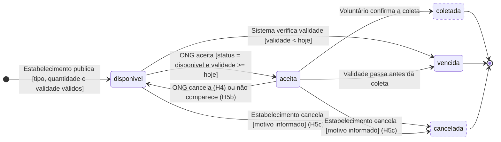
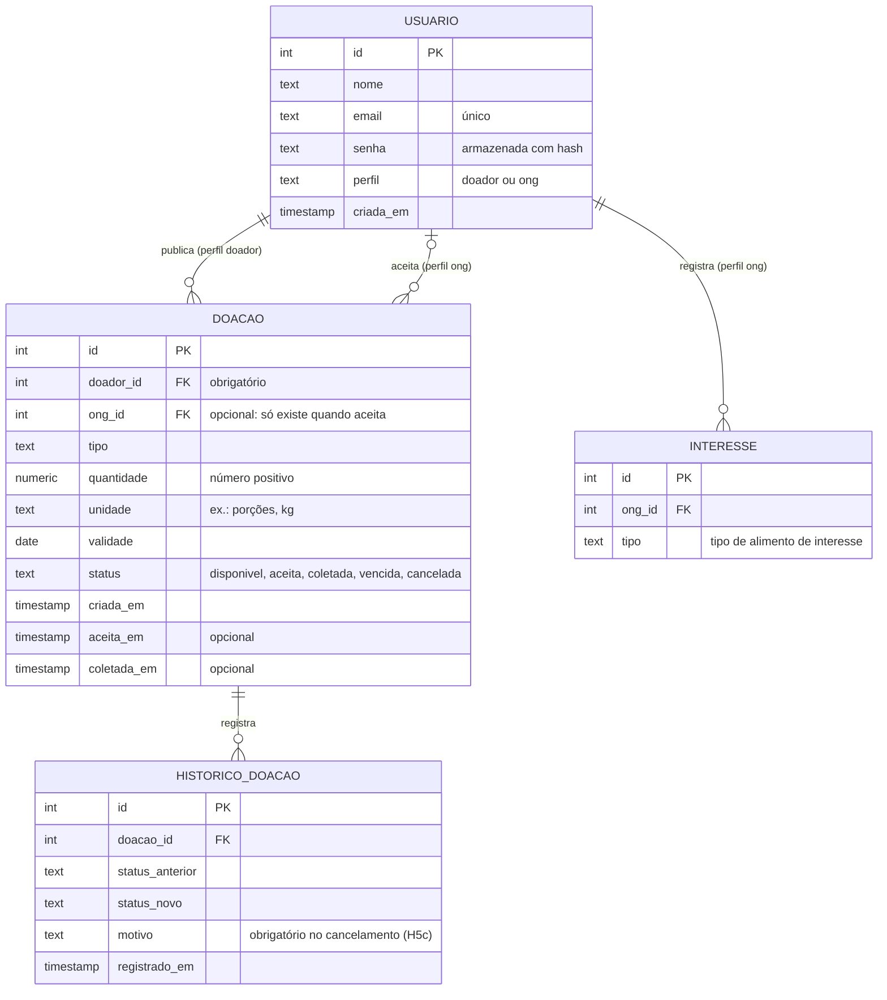
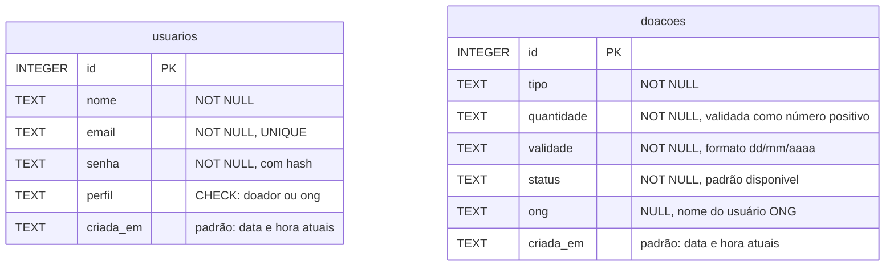

# Atividade de Diagramas — Prato Cheio

*N2 · Modelagem com apoio de IA · Grupo Prato Cheio*

**Integrantes:** Gabrieli (@gabilbck) · Heloisa (@HeloisaRebello17) · Julio (@JulioMattoos) ·
Mileine (@MileineFreitas) · Thomas (@thSteinback)

**Ferramenta de IA utilizada:** Claude (Anthropic).
**Ferramenta de diagramação:** Mermaid, em arquivos Markdown versionados no próprio repositório.

## Onde está cada parte da entrega

| Parte da atividade | Onde encontrar |
|---|---|
| Parte 1 — Diagramas escolhidos e justificativa | [Seção 1](#1-diagramas-escolhidos-e-justificativa) deste arquivo |
| Parte 2 — Versões originais geradas pela IA | [`docs/diagramas-ia-original.md`](diagramas-ia-original.md) |
| Parte 3 — Problemas identificados | [Seção 2](#2-análise-crítica-dos-diagramas-gerados-pela-ia) deste arquivo |
| Parte 4 — Versões finais | [Seção 3](#3-diagrama-de-estados--versão-final) e [Seção 4](#4-der--versão-final) deste arquivo |
| Reflexão final | [Seção 5](#5-reflexão-final) deste arquivo |
| Diagramas complementares (contexto, sequência, componentes) | [`docs/diagramas.md`](diagramas.md) |

---

## 1. Diagramas escolhidos e justificativa

Escolhemos o **Diagrama de Estados (UML)** e o **Diagrama Entidade-Relacionamento (DER)**.

Partimos da pergunta que mais nos preocupava depois da análise: *o sistema consegue garantir que
uma doação chegue a uma ONG antes de estragar, e consegue provar isso com dados?* Essa pergunta
tem duas metades, e cada diagrama responde a uma delas.

| Diagrama | Pergunta que responde | Por que é importante no Prato Cheio |
|---|---|---|
| **Estados (UML)** | Em que situações uma doação pode estar e quais eventos a fazem mudar? | Quase todas as regras de negócio do caso são, na prática, regras de mudança de estado: a doação aceita some para as outras ONGs, a doação vencida não pode ser aceita, a ONG que cancela devolve a doação para a lista. É também o comportamento protegido pela decisão de projeto #2 (verificação otimista no aceite). |
| **DER** | Quais dados guardamos e como eles se relacionam? | O experimento definido na análise depende de medir o tempo entre publicação e coleta. Só o modelo de dados mostra se o sistema guarda as informações necessárias para isso. Além disso, o DER pode ser confrontado diretamente com o schema real em `src/db.js`. |

Os dois diagramas são **complementares**: o atributo `status` da tabela de doações, no DER, é
exatamente o que o diagrama de estados descreve. Por isso usamos um para conferir o outro. Se um
estado aparece no diagrama de estados, o DER precisa ser capaz de armazená-lo, e cada transição
importante precisa deixar algum registro (uma data, um motivo) no banco.

Deixamos de fora os diagramas de sequência e de componentes nesta atividade, porque já haviam sido
produzidos na Aula 07 (estão em `docs/diagramas.md`) e respondem a perguntas que hoje nos parecem
mais estáveis: o fluxo da história zero e a divisão em camadas já estão implementados e testados.

---

## 2. Análise crítica dos diagramas gerados pela IA

Comparamos a versão original da IA ([`diagramas-ia-original.md`](diagramas-ia-original.md)) com
as histórias e regras de `docs/analise.md`, com as decisões de `docs/projeto.md` e com o código em
`src/`. Encontramos quatro problemas principais (dois em cada diagrama) e alguns ajustes menores.

### 2.1 Diagrama de estados

#### Problema 1 — O cancelamento pela ONG encerra a doação

- **Categoria:** regra de negócio ignorada.
- **Problema:** a IA modelou `Aceita --> Cancelada: ONG cancela a coleta`, e `Cancelada` é um
  estado final. Ou seja, quando a ONG desiste, a doação deixa de existir para todos.
- **Justificativa:** o critério de aceite da H4 diz o contrário: quando a ONG cancela dentro do
  prazo, *a doação volta a ficar disponível*. No contexto do Prato Cheio, esse erro é grave,
  porque provocaria exatamente o desperdício que o sistema quer evitar: um alimento ainda bom
  sumiria da lista só porque a primeira ONG não pôde buscá-lo. A IA também misturou dois
  cancelamentos diferentes: o da ONG (H4) e o do estabelecimento (H5c).
- **Correção:** o cancelamento pela ONG virou a transição `aceita --> disponivel`. O estado
  `cancelada` foi mantido, mas reservado ao cancelamento feito pelo **estabelecimento**, com
  motivo obrigatório (H5c), que é o único caso em que faz sentido encerrar a doação.

#### Problema 2 — "Não compareceu" representado como estado

- **Categoria:** uso inadequado da notação.
- **Problema:** a IA criou o estado `NaoCompareceu`, que só existe para levar de volta a
  `Disponivel`.
- **Justificativa:** na notação UML, um estado representa uma condição em que o objeto
  *permanece* por algum tempo, aguardando um evento. "A ONG não compareceu" não é uma condição em
  que a doação fica; é um **evento** que acontece com a doação aceita. Representá-lo como estado
  deixa o diagrama mais longo e sugere que o banco precisaria guardar o status `NaoCompareceu`, o
  que não corresponde a nenhuma regra do caso.
- **Correção:** o não comparecimento virou o evento de uma transição,
  `aceita --> disponivel : ONG não comparece (H5b)`, ao lado do cancelamento da H4.

#### Ajustes menores no diagrama de estados

- **Faltava a transição `aceita --> vencida`.** Uma doação aceita também pode perder a validade
  antes da coleta, e a regra "perecível se perde se não for coletado a tempo" vale nesse caso.
- **Faltavam as condições de guarda.** Sem `[validade >= hoje]` e `[status = disponivel]`, o
  diagrama não mostrava as duas regras que o código de fato verifica antes de aceitar.
- **Os nomes não coincidiam com o código.** A IA usou `Disponivel`, `Aceita` etc., enquanto o banco
  grava `disponivel`, `aceita` e `vencida`. Padronizamos os nomes pelos valores reais da coluna
  `status`.
- **O diagrama não distinguia o que já existe do que é planejado.** Hoje o código implementa apenas
  `disponivel`, `aceita` e `vencida`. Na versão final, os estados ainda não implementados aparecem
  tracejados.

### 2.2 DER

#### Problema 3 — Cardinalidade obriga toda doação a ter uma ONG

- **Categoria:** cardinalidade incorreta / inconsistência com a implementação.
- **Problema:** a IA usou `ONG ||--o{ DOACAO`. Na notação *crow's foot*, o `||` do lado da ONG
  significa que **toda doação está ligada a exatamente uma ONG**.
- **Justificativa:** no Prato Cheio, a doação nasce **sem ONG**. Ela só ganha uma ONG quando é
  aceita, e pode voltar a não ter nenhuma (H4 e H5b). Com a cardinalidade da IA, a doação
  disponível, que é justamente o estado mais importante do sistema, não poderia sequer ser
  gravada. O próprio código já trata isso de forma correta: em `src/db.js` a coluna `ong` aceita
  `NULL`, e o cancelamento da coleta (`repositorio.cancelarAceite`) volta a deixá-la `NULL`.
- **Correção:** a relação de aceite passou a ser de **zero ou uma** ONG por doação (`|o--o{`), e
  `ong_id` foi marcado como opcional.

#### Problema 4 — Entidade `NECESSIDADE` fora do escopo do piloto

- **Categoria:** elemento desnecessário.
- **Problema:** a IA incluiu a entidade `NECESSIDADE`, com quantidade e data limite, para
  representar a história 2 ("ONG publica sua necessidade").
- **Justificativa:** na *Decisão de análise* (`docs/analise.md`), o grupo retirou a história 2 do
  escopo, porque ela duplica o fluxo da história 1 e não é sustentada por nenhuma regra de
  negócio. No lugar dela, ficou uma versão enxuta: a ONG apenas **registra interesse por um tipo
  de alimento** e é avisada quando surge uma doação desse tipo. Manter `NECESSIDADE` no modelo
  levaria a equipe a construir um fluxo de "pedido" que decidimos conscientemente não fazer.
- **Correção:** `NECESSIDADE` foi substituída por `INTERESSE` (ONG + tipo de alimento), que é o
  mínimo necessário para atender à decisão de análise.

#### Ajustes menores no DER

- **Faltavam as datas que o experimento precisa.** A métrica de sucesso do piloto é o tempo entre
  publicação e coleta, mas a IA só previu `data_publicacao`. Acrescentamos `aceita_em` e
  `coletada_em`.
- **Não havia onde registrar o motivo do cancelamento (H5c).** Acrescentamos a entidade
  `HISTORICO_DOACAO`, que guarda cada mudança de status, com data e motivo.
- **`ESTABELECIMENTO` e `ONG` como tabelas separadas não correspondem ao sistema.** O produto passou
  a ter cadastro e login com uma única tabela `usuarios`, em que o campo `perfil` indica se a pessoa
  é `doador` ou `ong`. No modelo final, unificamos as duas entidades em `USUARIO`, e cada relação
  indica qual perfil participa dela.
- **`TIPO_ALIMENTO` como tabela foi considerado excessivo para o piloto.** O tipo é texto livre, e
  o filtro por tipo (H3), já implementado, funciona bem com isso. Mantivemos `tipo` como atributo da
  doação e registramos a tabela de tipos como possível evolução.
- **`quantidade` sem unidade não representa o caso.** A IA usou um inteiro, e o sistema atual
  também aceita apenas um número positivo, mas a análise fala em porções e quilos: "10" sozinho não
  diz quanto alimento existe. No modelo alvo, acrescentamos o atributo `unidade`.
- **O modelo ignorava o que já existe.** O banco real tem uma única tabela, `doacoes`. Por isso, a
  versão final apresenta o **modelo alvo** e, ao lado, o **modelo atual**, com a lista do que falta
  para chegar de um ao outro.

---

## 3. Diagrama de estados — versão final

Linha contínua indica estado já implementado; contorno tracejado indica estado previsto nas
histórias, mas ainda não implementado.

### Confronto com o código

| Transição | Quem provoca | Regra ou história | Implementada? | Onde |
|---|---|---|:--:|---|
| início → `disponivel` | Estabelecimento | H1: campos obrigatórios, validade não pode estar no passado | ✅ | `doacoes.criarDoacao` |
| `disponivel` → `aceita` | ONG | Aceite exclusivo (decisão #2) | ✅ | `repositorio.aceitar` (`UPDATE ... WHERE status = 'disponivel'`) |
| `disponivel` → `vencida` | Sistema | H5a | ✅ | `doacoes.listarDisponiveis` e `doacoes.aceitar` |
| `aceita` → `disponivel` (cancelamento) | ONG | H4 | ✅ | `doacoes.cancelar` e `repositorio.cancelarAceite` |
| `aceita` → `disponivel` (não comparecimento) | Sistema ou estabelecimento | H5b | ❌ | — |
| `aceita` → `coletada` | Voluntário | Fluxo principal do caso | ❌ | — |
| `aceita` → `vencida` | Sistema | Perecível se perde se não for coletado | ❌ | `marcarVencida` só atua sobre `disponivel` |
| `*` → `cancelada` | Estabelecimento | H5c | ❌ | — |

**Observação sobre a decisão #2:** a guarda `[status = disponivel]` da transição de aceite é
verificada pelo próprio banco, dentro do `UPDATE`. Por isso duas ONGs nunca levam a mesma doação:
quando a segunda tenta, a guarda já é falsa e nenhuma linha é alterada. O teste "aceita uma única
ONG quando duas tentam simultaneamente", em `tests/coletas.test.js`, comprova esse comportamento.
Da mesma forma, o cancelamento só acontece se a doação estiver `aceita` **pela mesma ONG** que pede
o cancelamento.

**Observação sobre a expiração:** no código atual, a passagem para `vencida` não acontece no
instante em que a validade termina, mas na próxima vez em que alguém lista ou tenta aceitar a
doação. Escolhemos isso para evitar um processo agendado (decisão #3). O diagrama representa o
comportamento esperado pelo usuário: uma doação vencida nunca é mostrada nem aceita.

---

## 4. DER — versão final

### 4.1 Modelo alvo (o que o caso exige)

### 4.2 Modelo atual (`src/db.js`)

O banco tem hoje duas tabelas, **sem chave estrangeira entre elas**. A ligação entre a doação e a
ONG que a aceitou é feita pelo **nome** do usuário, gravado como texto na coluna `ong`.

### 4.3 Do modelo atual ao modelo alvo

| Diferença | Consequência hoje | O que precisa mudar | Relacionado a |
|---|---|---|---|
| A doação guarda o **nome** da ONG (`ong TEXT`), e não o `id` do usuário | Duas ONGs cadastradas com o mesmo nome veriam e poderiam cancelar as coletas uma da outra; se a ONG mudar de nome, perde o vínculo com as doações | Coluna `ong_id` com chave estrangeira para `usuarios` | Identificação da ONG, decisão #2 |
| A doação não guarda quem a publicou | Não é possível avisar o doador (H4) nem listar "minhas doações" | Coluna `doador_id` com chave estrangeira para `usuarios` | H4, H5c |
| Não existem `aceita_em` e `coletada_em` | A métrica do experimento (tempo publicação → coleta) não pode ser calculada | Novas colunas de data | Hipótese e experimento |
| `quantidade` sem unidade | "10" pode ser 10 porções ou 10 kg; não dá para estimar refeições | Coluna `unidade` | Métrica complementar (refeições) |
| `validade` é texto `dd/mm/aaaa` | O banco não consegue comparar nem ordenar datas | Tipo `DATE` na migração para PostgreSQL | Decisão #1, H5a |
| Não há histórico de mudanças | O motivo do cancelamento não tem onde ser gravado | Tabela `HISTORICO_DOACAO` | H5c |
| Não há registro de interesse | A ONG não consegue ser avisada de novos tipos de doação | Tabela `INTERESSE` | Decisão de análise (alternativa c) |

O modelo alvo não precisa ser implementado de uma vez. A ordem que nos parece mais sensata é
começar pelas colunas `aceita_em` e `coletada_em`, porque sem elas o piloto não consegue medir o
próprio resultado, e pela troca do nome da ONG por `ong_id`, que hoje é o ponto mais frágil do
modelo.

---

## 5. Reflexão final

**Qual dos dois diagramas foi mais útil para compreender ou questionar uma decisão do projeto?
Por quê?**

O **DER** foi o mais útil. Enquanto olhávamos apenas para o código e para o diagrama de estados, o
sistema parecia quase completo: a doação é publicada, aparece, é aceita e some para as outras ONGs,
e os testes confirmam isso. Quando comparamos o DER com o schema real, ficou claro que o banco não
registra *quando* a doação foi aceita nem *quando* foi coletada. Com isso, a métrica de sucesso
que definimos na análise, a redução de 30% no tempo entre publicação e coleta, não poderia ser
calculada ao final do piloto. Ou seja, o produto funcionaria, mas o grupo não conseguiria provar se
ele resolve o problema.

O DER também nos fez questionar uma decisão anterior. A cardinalidade proposta pela IA obrigava
toda doação a ter uma ONG, e foi ao corrigir esse erro que percebemos como o nosso modelo depende
da ideia de uma doação "sem dono" esperando ser aceita. Isso reforçou a escolha da verificação
otimista (decisão #2): o aceite é justamente o momento em que a doação deixa de não ter ONG e passa
a ter uma, e esse momento precisa ser atômico. Ao desenhar a ligação entre `USUARIO` e `DOACAO`,
percebemos ainda que o banco atual identifica a ONG pelo nome, e não pelo `id`. É uma fragilidade
que o código e os testes não deixavam evidente, mas que o diagrama mostrou de imediato.

O diagrama de estados, por sua vez, foi o mais útil para conversar sobre as regras. Foi nele que
percebemos que "cancelar" significava coisas diferentes para a ONG e para o estabelecimento.

---

## Uso de IA

A primeira versão dos dois diagramas foi gerada com o Claude, a partir do caso, das histórias, das
regras de negócio e das decisões de projeto (o prompt completo está em
[`diagramas-ia-original.md`](diagramas-ia-original.md)). A IA também foi usada como apoio durante a
análise crítica e na redação deste documento.

Cada problema apontado foi conferido pelo grupo contra `docs/analise.md`, `docs/projeto.md` e o
código em `src/db.js`, `src/doacoes.js`, `src/repositorio.js` e `src/autenticacao.js`. As escolhas
de correção — como unificar doador e ONG em `USUARIO`, acrescentar a unidade à quantidade, não criar
a tabela de tipos de alimento e reservar o estado `cancelada` ao estabelecimento — foram decisões do
grupo, tomadas a partir das restrições do piloto (prazo curto, equipe pequena e escopo de um bairro).
