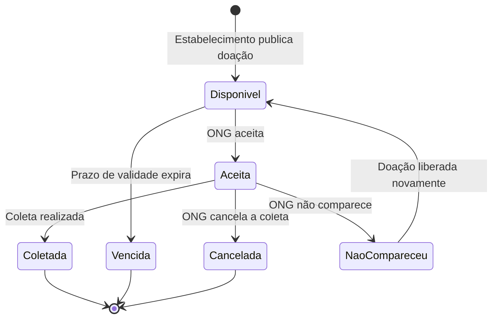
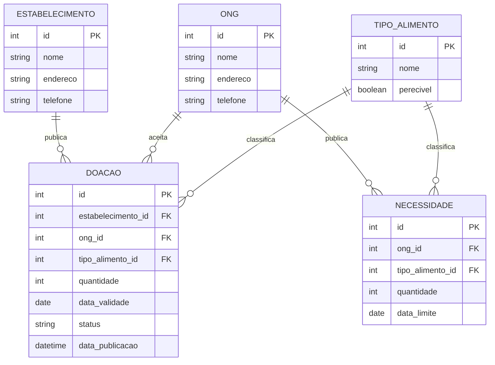

# Diagramas — versão original gerada pela IA

*Atividade de diagramas (N2) · registro da Parte 2*

> **Este arquivo não deve ser editado.** Ele guarda a primeira versão dos dois diagramas exatamente
> como a IA a produziu, para servir de base à análise crítica em
> [`diagramas-atividade.md`](diagramas-atividade.md).

## Como esta versão foi obtida

- **Ferramenta:** Claude (Anthropic).
- **Data da geração:** 23/10/2026.
- **Observação:** os primeiros rascunhos dos diagramas foram feitos em 07/10/2026 com o Claude Code,
  mas a conversa daquela sessão não foi guardada, e o primeiro commit de `docs/diagramas.md` já
  continha a versão corrigida. Por isso, geramos a versão original novamente, com o prompt abaixo, e a
  registramos aqui **sem nenhuma alteração**.
- **Informações fornecidas à IA:** apenas o caso, as histórias, as regras de negócio e as decisões de
  projeto. O código do repositório **não** foi fornecido nesta etapa, justamente para depois
  confrontarmos o modelo com a implementação real.

### Prompt utilizado

```text
Estou desenvolvendo o sistema "Prato Cheio", que conecta estabelecimentos que têm alimentos
excedentes a ONGs que os distribuem, antes que a comida se perca. Hoje a coordenação é feita
por WhatsApp. O piloto será em um bairro, com orçamento zero, em versão web para celular.

Histórias de usuário:
1. Como estabelecimento, quero publicar uma doação (tipo de alimento, quantidade e janela de
   retirada) para que ONGs próximas possam vê-la e coletá-la antes que estrague.
2. Como ONG, quero publicar minha necessidade de doação para que os estabelecimentos saibam o
   que estou buscando.
3. Como ONG, quero filtrar as doações disponíveis por tipo de alimento.
4. Como ONG, quero cancelar a coleta de uma doação que aceitei.
5a. A doação cuja validade expira passa a "vencida".
5b. Se a ONG não comparece, a doação volta a ficar disponível.
5c. O estabelecimento pode cancelar manualmente uma doação, registrando o motivo.

Regras de negócio:
- Doação exige tipo, quantidade e validade/janela de retirada.
- Perecível tem janela curta e se perde se não for coletado a tempo.
- Doação aceita por uma ONG some para as outras.
- ONG mais próxima leva vantagem logística.

Decisões de projeto:
- Para evitar que duas ONGs aceitem a mesma doação, usamos verificação otimista
  (UPDATE ... WHERE status = 'disponivel').
- Banco relacional: SQLite agora, PostgreSQL na próxima etapa.

Gere, em Mermaid:
(1) um diagrama de estados (UML) da doação;
(2) um diagrama entidade-relacionamento (DER) do banco de dados.
```

---

## 1. Diagrama de estados — versão original da IA



---

## 2. Diagrama entidade-relacionamento — versão original da IA

